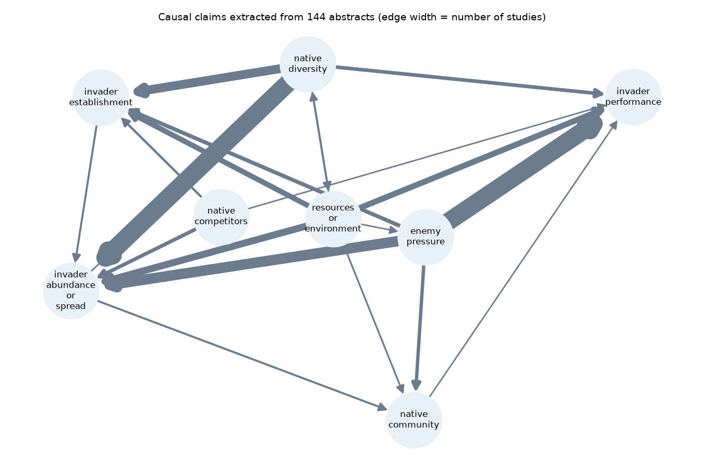

# Hypothesis Ledger

**Can a language model read ecology abstracts, extract their causal claims with sources, and judge whether a hypothesis is supported, the way experts did?**

Amrina · M.Sc. Educational Technology (Saarland University), B.Sc. Informatics

🌐 **Project page:** https://sayamrina.github.io/hypothesis-ledger/ · 👤 **Portfolio:** https://sayamrina.github.io

Invasion biology has a set of classic hypotheses that have each been tested in hundreds of studies. The *Hi Knowledge* initiative (Jeschke & Heger, 2018) read these studies and recorded, for each one, whether its findings **support**, **question** or leave **undecided** a hypothesis, together with habitat, organism and research method. These expert labels are published in the [Open Research Knowledge Graph](https://orkg.org) (ORKG).

This repository uses them as a test bed for AI-assisted evidence synthesis. For two hypotheses, an LLM reads each abstract and

1. extracts the causal claims it makes, each with a **verbatim quote** as evidence,
2. decides whether the study supports the hypothesis,
3. writes everything into an **RDF knowledge graph with provenance** (PROV-O), validated with **SHACL** and queryable with **SPARQL**.

The results are then compared with the expert labels, at the level of single studies and at the level of the synthesis ("how often is the hypothesis supported, and does that depend on the study design?").

It is a small pilot, not a finished study: one model, abstracts only, 144 studies (see *Limitations*).

| Hypothesis | Statement used in the prompt | ORKG comparison |
|---|---|---|
| Enemy release | The absence of enemies in the exotic range is a cause of invasion success. | [R58002](https://orkg.org/comparison/R58002) |
| Biotic resistance | An ecosystem with high biodiversity is more resistant against non-native species than an ecosystem with lower biodiversity. | [R57501](https://orkg.org/comparison/R57501) |

## Pipeline

```
ORKG (expert labels) ──┐
                       ├─► data/studies.jsonl ─► LLM extraction ─► quote check ─► RDF graph + SHACL ─► SPARQL
Crossref / OpenAlex /  │      (144 studies)      (2 conditions)    (1 retry)       results/ledger.ttl
Semantic Scholar ──────┘                                │
                                                        └─► evaluation vs. experts, LLM-as-a-judge, causal graph
```

| Step | File | What it does |
|---|---|---|
| Harvest | `src/harvest.py` | Reads the two ORKG comparisons (418 contributions from 318 papers), resolves missing DOIs by title on Crossref, fetches abstracts from OpenAlex, Crossref or Semantic Scholar. 144 paper–hypothesis items have an abstract. When one paper has several contributions with different expert labels, the item is marked `mixed` and left out of accuracy (13 items). |
| Extract | `src/extract.py` | GPT-4o-mini (`gpt-4o-mini-2024-07-18`, temperature 0) with structured outputs (Pydantic). **direct**: verdict only. **claims**: first a list of causal claims (cause, effect, a category for each, direction, organism, habitat, verbatim quote) and the study design, then the verdict. Quotes that are not found in the abstract are sent back once for correction. |
| Graph | `src/build_graph.py`, `shapes/ledger_shapes.ttl` | Studies and hypotheses are linked to their ORKG resources. Each claim carries its quote (`prov:value`), its source DOI (`prov:wasDerivedFrom`) and the extraction run (`prov:wasGeneratedBy`). SHACL checks that every claim has exactly one quote and one source, and that verdicts use the allowed values. 7,720 triples; SHACL conforms. |
| Query | `queries/*.rq`, `src/query.py` | Disagreements with the experts (with the quote the model relied on), support by study design, claims whose quote could not be verified. |
| Judge | `src/judge.py` | A second GPT-4o-mini call rates whether each verdict is correct, without seeing the expert label. |
| Page data | `src/export_page_data.py` | Writes `docs/studies.json` for the project page (one record per study, both verdicts, one verified quote). |
| Evaluate | `src/evaluate.py` | Accuracy, macro-F1, McNemar test, provenance, design agreement, support shares, Fisher tests, judge agreement, causal graph. Output: `results/metrics.json`, `results/causal_graph.png`. |

## Results

**1. Verdicts agree with the experts in about three of four studies.** On the 131 items with a single expert label:

| Condition | Accuracy | Macro-F1 | Correct "undecided" (of 20) |
|---|---|---|---|
| Majority class | 0.43 | – | – |
| direct | 0.76 | 0.60 | 2 |
| claims first | 0.75 | 0.66 | 7 |

Extracting claims first did not change accuracy (exact McNemar test: 6 items only *direct* got right, 5 only *claims* got right, p = 1.0), but it recognised more mixed results as *undecided*, which raises macro-F1. Most errors are on the boundary between *undecided* and the other two labels; *supported* is almost never confused with *questioned* (2 of 55).

**2. Provenance can be enforced.** The model extracted 450 causal claims (3.1 per study). In 11 studies at least one quote was not verbatim; after one correction round, 99.3% of all quotes are exact spans of the abstract, and the remaining ones are flagged in the graph (`hl:quoteVerified false`) instead of hidden.

**3. Study design is read reliably.** The design the model read from the abstract (experimental vs. observational) matched the expert's research-method label in 91% of 133 studies.

**4. Study design changes the conclusion, and in opposite directions for the two hypotheses.** In the expert labels:

| Hypothesis | Supported in experimental studies | Supported in observational studies | Fisher exact |
|---|---|---|---|
| Enemy release | 4 of 13 | 25 of 34 | OR = 0.16, p = .017 |
| Biotic resistance | 16 of 28 | 6 of 27 | OR = 4.67, p = .013 |

Enemy release is mostly supported by observational comparisons (for example of damage in the native and invaded range), but much less when enemies are manipulated in experiments. Biotic resistance is mostly supported in experiments and mostly questioned in observational studies, probably reflecting the scale dependence often discussed for this hypothesis (experiments tend to be small plots, observational studies larger areas); this sample does not test that explanation. A synthesis that does not separate designs answers a different causal question than it seems to. The LLM labels show the same direction for both hypotheses (OR = 0.34 and 2.91) but weaker and not significant (p = .12 and .10), and the LLM overestimates support for biotic resistance overall (55% vs. 42% in the expert labels).

**5. An LLM judge is too lenient to replace expert checking.** The judge rated 85.5% of verdicts as correct; 74.8% were. Its ratings agreed with the expert check in 74% of cases, but Cohen's κ was only 0.20.

**6. Causal direction is the weak point.** For the edge the enemy release hypothesis is about (enemy pressure → invader performance) the model coded "increases" 30 times and "decreases" 21 times, although more enemy pressure should mean lower performance. It often codes the direction of *enemy release* while naming the node *enemy pressure*. The causal graph (`results/causal_graph.png`) therefore shows which factors the studies link, weighted by the number of studies, but not the sign.



## What I take from this

- At study level, structured extraction with verified quotes makes every verdict checkable, which is more useful than a slightly higher accuracy.
- At synthesis level, the important information is conditional: *under which design, habitat or scale* a hypothesis holds. The model recovered the direction of the design effect but not its strength.
- Signs of causal relations need their own representation and check (e.g. a fixed variable with a defined polarity, or two-step extraction "variable, then change"), and a judge model needs calibration against experts before it is used as an evaluator.

## Limitations

- Abstracts only; the expert labels are based on full texts. Some disagreements are probably caused by information that is not in the abstract.
- 144 of 318 papers had an abstract that could be retrieved; terrestrial studies dominate (freshwater and marine together < 15%), so habitat comparisons were not possible.
- One model, one run, temperature 0; no prompt tuning on a separate development set, so the reported accuracy is not an optimised result.
- The categories for causal nodes were chosen by me before the run; another set could change the graph.
- Total model use: about 291,000 tokens for both conditions (well under 1 USD with GPT-4o-mini), plus the judge.

## Reproduce

```bash
python -m venv .venv && .venv/bin/pip install -r requirements.txt
.venv/bin/python src/harvest.py                         # ORKG + abstracts (cached in data/raw/)
export OPENAI_API_KEY=...
.venv/bin/python src/extract.py claims && .venv/bin/python src/extract.py direct
.venv/bin/python src/judge.py
.venv/bin/python src/evaluate.py && .venv/bin/python src/build_graph.py
.venv/bin/python src/query.py queries/disagreements.rq
.venv/bin/python -m pytest -q tests
```

Abstracts are not included in this repository; `harvest.py` fetches them again. `data/items.csv` lists the 144 items with DOI and expert labels.

## Data and licences

- Expert labels: Hi Knowledge data in the Open Research Knowledge Graph (ORKG, TIB), published under CC BY-SA. Derived files in `data/` and `results/` are shared under the same licence.
- Jeschke, J. M., & Heger, T. (Eds.) (2018). *Invasion Biology: Hypotheses and Evidence.* CABI.
- Evidence quotes are short spans from the abstracts of the cited studies, each linked to its DOI.
- Code: MIT.

This project was built by Amrina, with AI as a supporting tool for coding.
